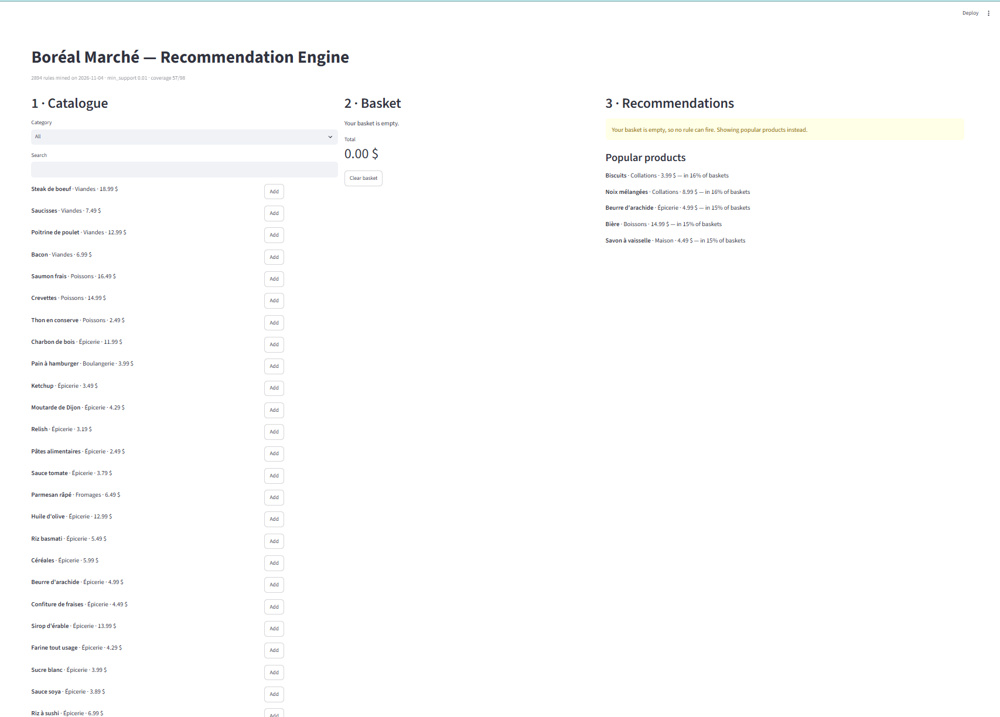
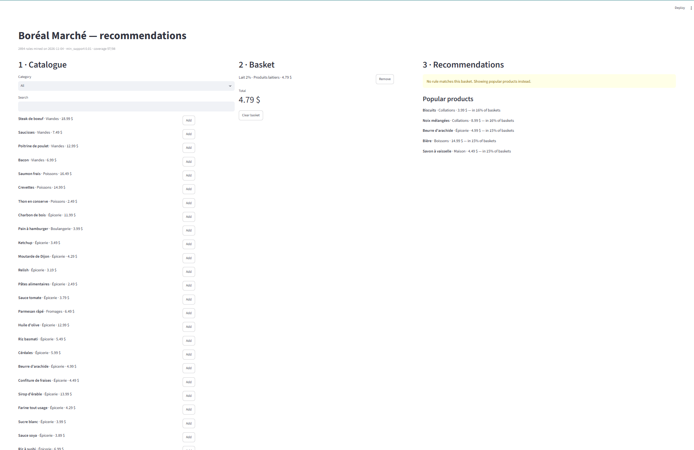
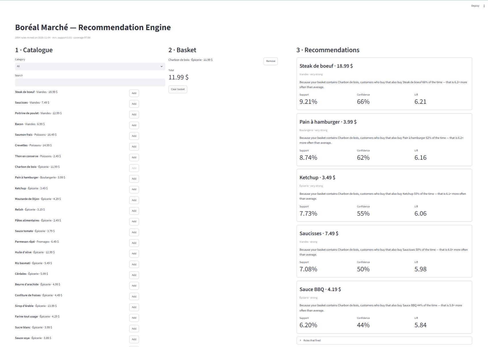
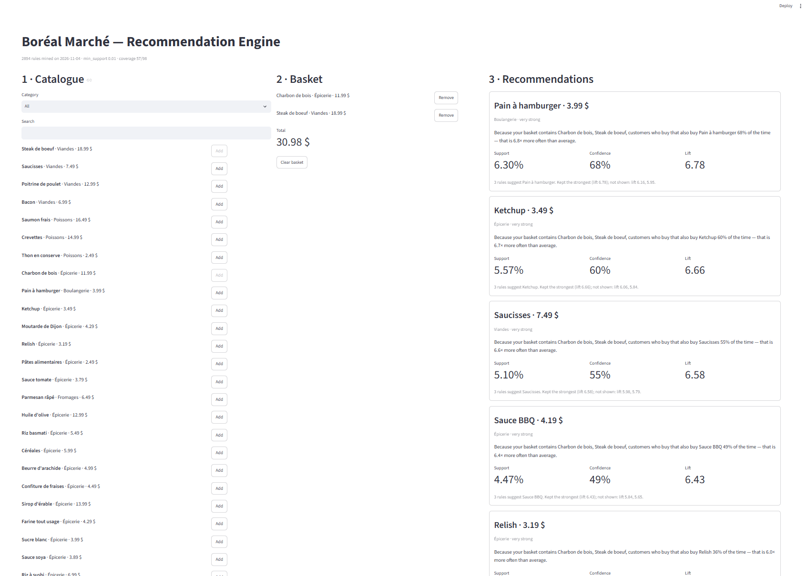
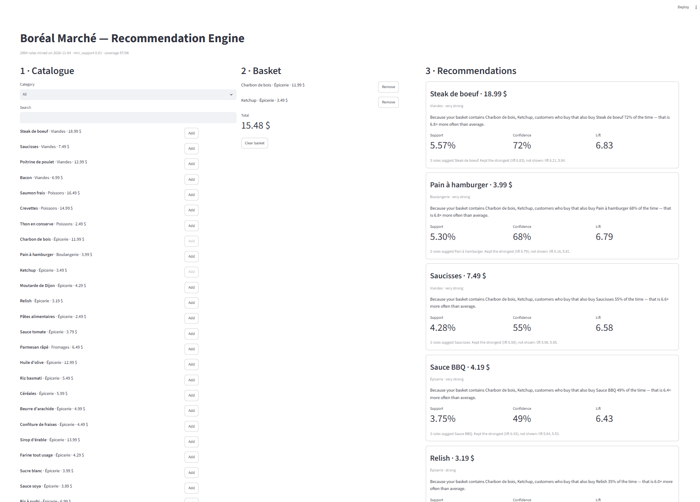
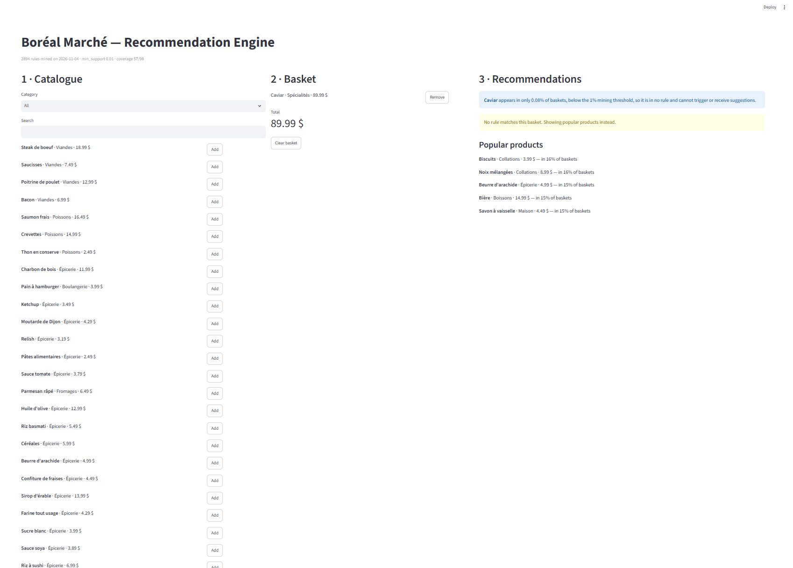
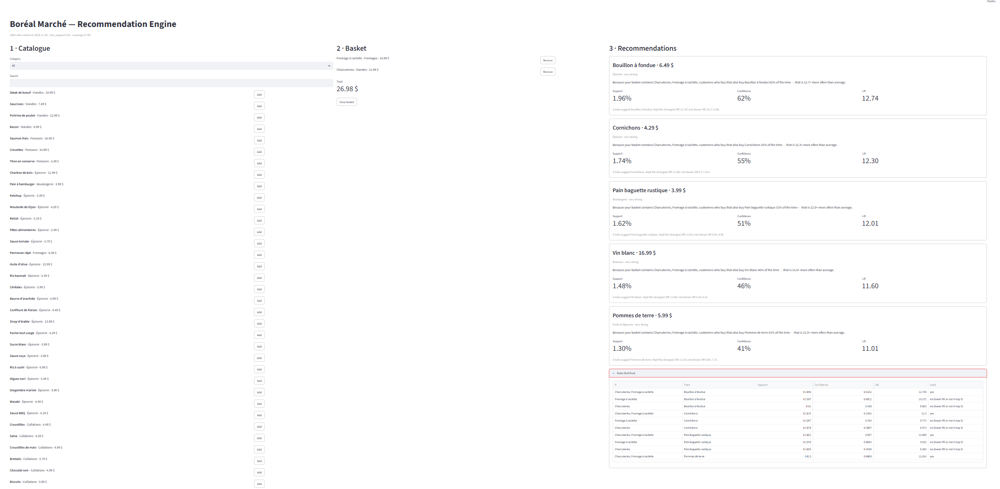
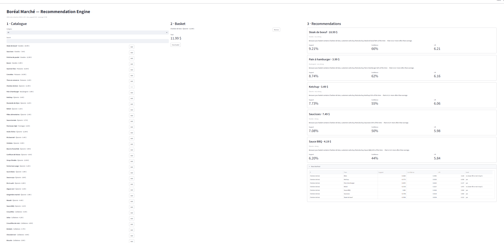

# boreal-reco-knikop

A basket-based recommendation engine for **Boréal Marché**, a Québec online grocery store. It answers one question:

> *Given what this customer has already put in their basket, what should we suggest next — and why?*

Rules are mined offline with **Apriori** (`mlxtend`) from one year of transactions: 1,000,000 baskets and 98 products. A **Streamlit** app then serves suggestions instantly and explains each one with the rule behind it.


## Overview
The system is split in two, and the app never mines anything.

| | Offline — mining | Online — recommending |
| --- | --- | --- |
| Where | `notebooks/01_mining.ipynb` | `app/streamlit_app.py` |
| What | Loads transactions, builds the boolean table, runs Apriori, filters rules | Loads the saved rules, matches them to the basket, ranks by lift |
| Output / input | writes `models/rules.json` and `models/metadata.json` | reads `models/rules.json` and `models/metadata.json` |
| Cost | about 3 minutes for the whole notebook | instant |

```
boreal-reco-knikop/
├── README.md
├── requirements.txt
├── data/
│   ├── transactionsdata.zip     ← 8,379,837 rows (TransactionID, Date, CustomerID, Item)
│   └── products.csv             ← 98 products (Item, Item_EN, Category, Price)
├── notebooks/
│   └── 01_mining.ipynb          ← executed, all outputs visible
├── models/
│   ├── rules.json               ← 2,894 filtered rules
│   └── metadata.json            ← thresholds, mining date, counts, coverage, item frequencies
├── app/
│   └── streamlit_app.py
├── reports/
│   ├── benchmark.md             ← timing and memory measurements
│   ├── apriori_default_runs.csv
│   └── apriori_lowmem_runs.csv
└── screenshots/            ← app screenshots used below
```

## How to run 

Tested with Python 3.12.16, pandas 3.1.0, numpy 2.5.4, mlxtend 0.25.0.

```bash
git clone https://github.com/knikop/boreal-reco-knikop.git
python -m venv .venv
pip install -r requirements.txt
```

or

```bash
git clone https://github.com/knikop/boreal-reco-knikop.git
cd boreal-reco-knikop

conda create -n boreal python=3.12
conda activate boreal
pip install -r requirements.txt
```

**1. Mine the rules (optional — `models/` is already committed).** Open `notebooks/01_mining.ipynb` and run *Kernel → Restart & Run All* (about 3 minutes). The slow default-settings Apriori test is off by default (`RUN_DEFAULT_APRIORI = False` in the first cell), because it needs 8–73 GB of RAM.

**2. Start the app** from the repository root:

```powershell
python -m streamlit run app/streamlit_app.py
```

The app only reads `models/rules.json`, `models/metadata.json` and `data/products.csv`. It does not import mlxtend.


## Results

| | |
| --- | --- |
| Baskets / products / items per basket | 1,000,000 / 98 / 8.38 |
| Wide table build | 1.04 s, 106 MB (`crosstab`: 63.4 s) |
| Final thresholds | min_support 0.01 · min_confidence 0.1 · lift > 1.2 · single-item consequent |
| Mining time at 0.01 | 18.3 s, 0.18 GB peak (`low_memory=True`) |
| Rules mined → saved | 13,731 → **2,894** |
| Coverage | **57 of 98 products** can ever be recommended |

**Confidence vs lift (the key finding).** Ranked by confidence, all top 10 rules (and 100% of the top 50) are "X → Sac réutilisable", with confidence 0.90 but lift 1.00. The reusable bag is in 90% of baskets, so it shows up after anything, and these rules carry no information. Ranked by lift, the top rules are real meal bundles: raclette (Fromage à raclette ↔ Bouillon à fondue, lift 10.2), sushi (Algues nori ↔ Riz à sushi, 9.5) and baby care (Couches ↔ Lingettes pour bébé, 9.5). The app therefore ranks suggestions by lift. My Phase 1 prediction that the bag would flood the high-confidence rules was correct.

**Seasonality.** Summer and winter produce different rule sets: 27,871 vs 9,446 rules, with only 6,413 in both. BBQ rules (Saucisses → Sauce BBQ, lift 3.3) exist only in summer, and raclette rules (Fromage à raclette → Bouillon à fondue, lift 6.8) only in winter. 6,394 of the 13,731 year-round rules (47%) don't exist in January data. Mining takes 18 s, so I recommend re-mining at least monthly, or keeping one rule set per season. Details are in the notebook, Phase 4.

Full measurements are in [`reports/benchmark.md`](reports/benchmark.md).


## Decisions

| Decision | Choice | Why |
| --- | --- | --- |
| Wide-format method | `pd.factorize` + NumPy bool array | 61× faster than `crosstab` and 1 byte per cell |
| Apriori setting | `low_memory=True` | the default raises a MemoryError from min_support 0.01 (14.2 GiB needed) |
| min_support | 0.01 | 13,731 rules in 18 s, itemsets up to 7 items; 0.005 triples the rules with no gain in coverage |
| Lift filter | lift > 1.2 instead of lift > 1 | lift > 1 still kept 586 of 1,017 bag rules (lift 0.992–1.009); 1.2 removes them all, and every real bundle is above 3 |
| Consequent size | one item only | one rule = one suggestion; `A → B + C` is already covered by `A → B` and `A → C` |
| Duplicate product | **kept Baguette and Pain baguette rustique separate** | Baguette is flat all year with no strong partner; the rustic baguette is seasonal and part of the raclette bundle (lift 9.55). Their mutual lift is 1.03, and merging would drop the raclette lift to 4.09. |
| Ranking | descending lift, best rule per product | rewards suggestions that change behaviour, not popular items |
| Strength label | weak < 1.5 ≤ moderate < 3 ≤ strong < 6 ≤ very strong | thresholds on lift; every rule in the app is at least 1.2 |
| Fallback | 5 most popular products, excluding the bag | used when the basket is empty or no rule fires |
| `products.csv` columns | joined on `Item` (French name) | the brief lists `Item, Item_FR`, but the file actually has `Item` (French) and `Item_EN`; the transactions use the French names |


## Traps I hit

The honest list of what went wrong and how I found it.

1. **MemoryError and a frozen PC.** Apriori with default settings needed 7.97 GiB at 0.02, 14.2 GiB at 0.01 and 72.6 GiB at 0.005. At 0.02 it failed once and succeeded once, after Windows swapped to disk for 3.5 minutes. The fix was `low_memory=True` (explained in `benchmark.md`). I then put the test behind a flag so *Restart & Run All* doesn't freeze the machine, and the recorded results are shown instead.
2. **Phase 3 ran on the wrong rules.** The benchmark loop leaves `rules` holding the *last* run (0.005, 41,952 rules), so my first Phase 3 results used the wrong threshold. The bag count came out as 12,309. I added an explicit re-mining cell at 0.01 before Phase 3.
3. **The bag survived `lift > 1`.** I expected the lift filter to remove the bag rules, but their lift sits just around 1 (0.992–1.009), and 586 of them passed. I raised the cut-off to 1.2.
4. **Counting the bag rules wrongly.** Testing `'Sac réutilisable' in consequents` also matched rules like "X → bag + Steak", whose high lift comes from the steak, and gave about 4,000. The correct test is `consequents == {'Sac réutilisable'}`, which gives 1,017.
5. **Missing output.** `freq.head(10); freq.tail(5)` only showed the bottom 5, because Jupyter displays only a cell's last expression. Fixed with `display()`.
6. **Wrong import.** `import association_rules` raised `ModuleNotFoundError`. It comes from `mlxtend.frequent_patterns`. All imports are now in the notebook's first cell.
7. **Date alignment risk in Phase 4.** Joining dates to a table with a plain 0…N index gives wrong months without any error. The basket table is indexed by `TransactionID`, and an `assert` checks that every basket gets a month.


## Edge Cases

All five graded edge cases were tested in the running app.

| Situation | Expected behaviour | Result | Screenshot |
| --- | --- | --- | --- |
| Empty basket | Clear message + fallback to popular products | "Your basket is empty, so no rule can fire." + top 5 products (bag excluded) |  |
| No rule fires | Explicit message + fallback | Basket = Lait 2% → "No rule matches this basket." + popular products |  |
| Item already in basket | Never suggested again | Charbon de bois → Steak is the top suggestion; after adding Steak it disappears from the list |  |
| Two rules suggest the same item | Keep the higher-lift one | Charbon de bois + Ketchup: three rules suggest Steak de boeuf (lift 6.83, 6.21, 5.84); it appears once, from the 6.83 rule(strongest rule is kept) "Charbon de bois + Ketchup → Steak" |  |
| Very rare product | Explain why it is in no rule | Basket = Caviar → "Caviar appears in only 0.08% of baskets, below the 1% mining threshold, so it is in no rule…" |  |

Example recommendations:

- **Charbon de bois** → Steak de boeuf, Pain à hamburger, Ketchup, Saucisses, Sauce BBQ
- **Fromage à raclette + Charcuteries + Bouillon à fondue** → Cornichons, Pain baguette rustique, Vin blanc, Pommes de terre

#### Recommendation for raclette basket


#### Recommendation for charbon de bois



## Limitations

1. **41 of 98 products can never be recommended.** These are the five specialty items (about 0.08% support, below any affordable threshold), the bag (excluded on purpose) and 35 everyday staples that are bought with everything, so no rule reaches lift 1.2. This builds in popularity bias. *Fix:* item-to-item lift from the co-occurrence matrix for rare items, per-category support thresholds, and a content-based fallback within the category.
2. **No notion of time.** One rule set covers the whole year, but 47% of year-round rules don't exist in January data. *Fix:* one rule set per season, switched by date, plus monthly re-mining (18 s per run).
3. **Not personalised.** Two customers with the same basket get the same suggestions, even though `CustomerID` is in the data. *Fix:* use purchase history (customer-level collaborative filtering).
4. **Cold start.** An empty basket can only show best-sellers, which reinforces popularity.


## Ethics

### 3 ethics points

- **Law 25 (Québec):** every suggestion can be traced to a named rule with its three metrics in "Rules that fired", so the automated decision is explainable to the customer.
- **Correlation is not causation:** the data reproduces the famous "diapers and beer" story from retail analytics. Couches → Bière has confidence 36.6% and lift 2.43, so diaper buyers buy beer 2.4× more often than average. The rule proves no causal link. A hidden third factor, such as a parent doing a big weekend shop, can drive both purchases, and the rule cannot tell which way influence runs, if it runs at all. Putting beer next to diapers might change nothing.
- **Reinforcement bias:** only 57 of 98 products can ever be suggested, so the system keeps promoting what is already bought together. Recommendations then shape future data, which locks the pattern in.